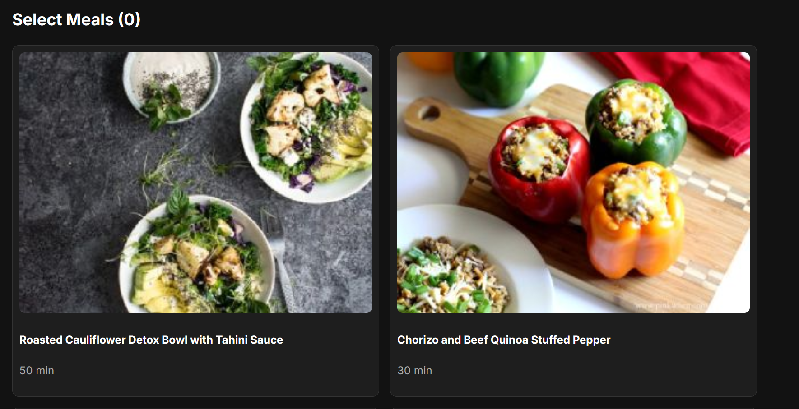

# Feed Me: Meal Planning Application

A full-stack web app that turns your diet, allergy, and disliked-ingredient selections into filtered meal options and a consolidated, categorized grocery list.

Capstone project, SUNY Potsdam (advisor: Dr. Grabowski). Originally developed on my university's Gitea server and moved to GitHub.



## Features
- **Personalized meal options:** filter recipes by diet, allergies, and disliked ingredients
- **Smart allergy handling:** broad categories (e.g., "nut") expand into specific ingredients
- **Consolidated grocery list:** duplicate ingredients are merged, quantities summed, and items grouped into categories like produce, proteins, and spices
- **Rate-limit fallback:** a local JSON recipe dataset matching the Spoonacular response format keeps the app working when the API's daily limit is reached
- **React interface:** card-based meal browsing, pagination that preserves your selections, recipe instructions, and a copyable grocery list

## Tech Stack
| Layer | Tools |
|-------|-------|
| Frontend | React, Vite |
| Backend | Node.js, Express |
| Data | Spoonacular API, local JSON fallback dataset |
| Workflow | Git, Trello |

## How It Works
1. The backend queries Spoonacular, or the local dataset if the API is unavailable.
2. Allergy categories are expanded into specific ingredients and recipes are filtered.
3. Ingredient names are normalized (lowercased, descriptors like "fresh" and "chopped" removed) so duplicates match.
4. Matching ingredients are grouped, quantities are summed, and the list is organized into categories.

## Getting Started

**Prerequisites:** Node.js 18+ and a free [Spoonacular API key](https://spoonacular.com/food-api).

```bash
# Backend (http://localhost:3000)
cd backend
npm install
# create backend/.env and add: SPOONACULAR_API_KEY=your_key_here
npm run dev

# Frontend (http://localhost:5173), in a second terminal
cd frontend
npm install
npm run dev
```

Without an API key, the app falls back to the local recipe dataset.

## Author
Christopher Perez | [LinkedIn](https://www.linkedin.com/in/chris583)